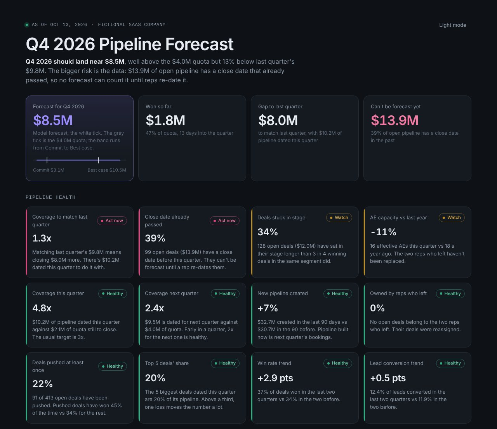
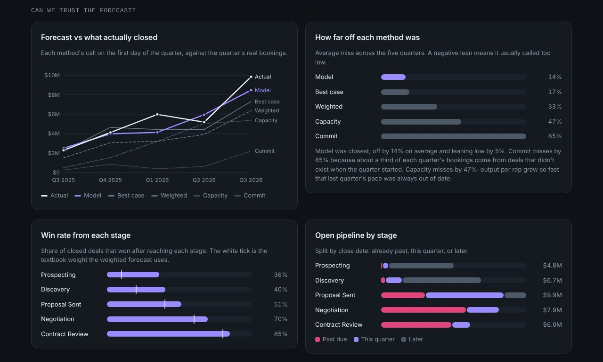
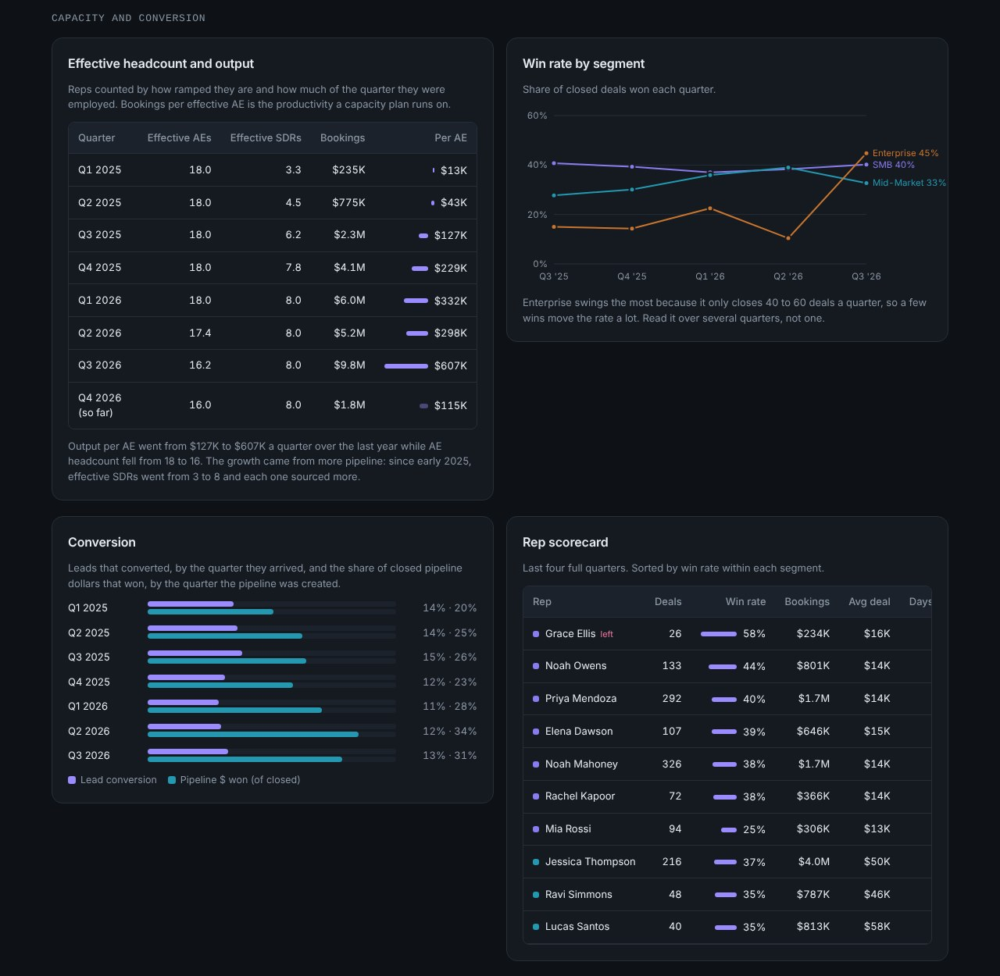

# Pipeline Forecast and Health

How much will close this quarter, and is the pipeline healthy enough to get there? This project forecasts the quarter five ways, back-tests each method on five past quarters to see which one to trust, checks twelve pipeline health signals, and tracks the capacity and conversion behind the number: effective headcount, rep productivity, lead and pipeline conversion, and win rates.

It runs on CRM data from gtm-synthetic-data, a private repo of data based on a fictional SaaS company. Every record is made up. The snapshot date is Oct 13, 2026, two weeks into Q4.

**[Open the live dashboard](https://maleekduckett.github.io/pipeline-forecast/)**



## The call for Q4 2026

| | |
|---|---|
| Forecast | $8.5M (range $3.1M Commit to $10.5M Best case) |
| Quota | $4.0M |
| Last quarter | $9.8M |
| Won so far | $1.8M |
| Open pipeline that can't be forecast | $13.9M |

The team should clear quota easily but will probably land about 13% below last quarter. Pipeline dated this quarter only covers what's needed to match last quarter 1.3 times.

The bigger problem is the data. $13.9M of open pipeline (39%) has a close date that's already passed. No method can place those deals in a quarter until a rep re-dates them, so they're left out of every forecast and flagged on their own. My [crm-data-hygiene](https://github.com/maleekduckett/crm-data-hygiene) project flags the same deals.

## Which forecast to trust

Each method made its call on the first day of each quarter, using only what was known that day. Then I compared it to what actually closed.

| Method | How it works | Average miss | Lean |
|---|---|---|---|
| Model | Each deal times the win rate its stage and segment have earned so far, cut for deals that slip, plus deals that will be created and won inside the quarter | 14% | 5% low |
| Best case | Every deal in Proposal Sent or later | 17% | 12% low |
| Weighted | Each deal times a textbook stage weight (10% for Prospecting up to 80% for Contract Review) | 33% | 33% low |
| Capacity | Effective AE headcount times recent bookings per ramped AE. Ignores pipeline entirely | 47% | 47% low |
| Commit | Deals in Contract Review | 85% | 85% low |

Two things explain the gaps:

1. **About 30% of each quarter's bookings come from deals that didn't exist when the quarter started.** That's mostly fast SMB deals. Any method that only counts today's pipeline will call low, which is why Commit misses so badly. The model adds an estimate for these deals based on the last two quarters.
2. **The textbook weights are too low.** In this data, 36% of deals that reached Prospecting went on to win, against a 10% weight. Weights should come from your own win rates.
3. **The capacity method lags a fast-growing team.** It assumes each rep will close what they closed recently, but output per rep grew almost 5x in a year. It's still a useful top-down check: for Q4 it says $7.2M against the model's $8.5M.



## Health signals

Each signal gets a status: red (act now), amber (watch) or green (healthy). The thresholds are in `common.py`.

| Signal | Value | Status | What it means |
|---|---|---|---|
| Coverage to match last quarter | 1.3x | Red | $10.2M dated this quarter to close $8.0M more |
| Close date already passed | 39% | Red | 99 open deals, $13.9M |
| Deals stuck in stage | 34% | Amber | 128 deals have sat in their stage longer than 3 in 4 winning deals in the same segment |
| AE capacity vs last year | -11% | Amber | 16 effective AEs vs 18. The two reps who left weren't replaced |
| Coverage this quarter | 4.8x | Green | Against the $2.1M of quota left |
| Coverage next quarter | 2.4x | Green | $9.5M dated for Q1 |
| New pipeline created | +7% | Green | Last 90 days vs the 90 before |
| Owned by reps who left | 0% | Green | Their deals were reassigned |
| Deals pushed at least once | 22% | Green | 91 of 413 open deals |
| Top 5 deals' share | 20% | Green | Of this quarter's pipeline |
| Win rate trend | +2.9 pts | Green | Last two quarters vs the two before |
| Lead conversion trend | +0.5 pts | Green | 12.4% of leads converted vs 11.9% |

"Stuck" compares each deal to winning deals in its own segment. My first version used one limit for every deal and flagged 65% of pipeline, because Enterprise deals naturally move slower than SMB.

One result surprised me. Deals that got pushed won more often (45%) than deals that didn't (34%). In this data, a push usually means a deal is still alive. That's worth checking on real data before treating every push as a warning.

Four reps have less than 1x coverage for the rest of the quarter. The dashboard lists every rep and the biggest stuck deals.

## Capacity and conversion

A rep isn't a full rep until they've ramped. Effective headcount counts each AE by how far into a three-month ramp they are (25%, 50%, 75%, then full) and how much of the quarter they were employed. SDRs get a two-month ramp.

| Quarter | Effective AEs | Effective SDRs | Bookings | Per effective AE |
|---|---|---|---|---|
| Q3 2025 | 18.0 | 6.2 | $2.3M | $127K |
| Q4 2025 | 18.0 | 7.8 | $4.1M | $229K |
| Q1 2026 | 18.0 | 8.0 | $6.0M | $332K |
| Q2 2026 | 17.4 | 8.0 | $5.2M | $298K |
| Q3 2026 | 16.2 | 8.0 | $9.8M | $607K |

Bookings grew while AE headcount shrank, so the growth came from pipeline. Effective SDRs went from 3 to 8 after five hires in 2025, and pipeline created per SDR roughly tripled.

- **Lead conversion** has stayed flat at 11% to 15% of leads a quarter.
- **Pipeline conversion:** for pipeline created in 2025, 20% to 25% of the dollars closed won. Newer pipeline is converting better so far (28% to 34% of closed dollars), but much of it is still open.
- **Win rates by segment:** SMB is steady around 40%. Mid-Market has climbed from 28% to the mid 30s. Enterprise swings between 10% and 45% because it only closes 40 to 60 deals a quarter.
- **Rep scorecard:** within SMB, Noah Mahoney closed 326 deals over the last year while Rachel Kapoor closed 72, so workload is uneven. Mia Rossi has the lowest SMB win rate (25%) and the lowest coverage this quarter (0.5x).



## What the files do

| File | Job |
|---|---|
| `common.py` | Settings, thresholds, and the function that rebuilds the pipeline as it stood on any past date |
| `forecast.py` | The four methods, the back-test, and this quarter's forecast |
| `health.py` | The twelve health signals and coverage by rep |
| `capacity.py` | Effective headcount with ramp, bookings per effective AE, and the capacity forecast |
| `report.py`, `sql/report.sql` | SQL summaries: bookings, win rates by segment and quarter, the stage funnel, slippage, open pipeline by stage, lead and pipeline conversion, and a rep scorecard |
| `build_dashboard.py`, `dashboard/template.html` | Builds the dashboard |
| `tests/test_rules.py` | Checks the pipeline rebuild, the no-peeking rule, ramp and headcount math, and the signal thresholds |

## Run it

The scripts expect the gtm-synthetic-data folder next to this repo. That repo is private, so the results are committed in `results/`.

```bash
pip install -r requirements.txt
python capacity.py
python forecast.py
python health.py
python report.py
python build_dashboard.py
python tests/test_rules.py
```

## Limits

- The CRM only keeps a deal's first and final close dates, not every date in between. So the back-test uses the first close date as what the rep expected at the time. Amounts are treated as fixed too.
- Five quarters is a short back-test. The company also grew fast over that time, so the model's estimate for in-quarter deals lags a little, which is part of why it leans low.
- Quotas in the data stay flat while bookings grew more than 4x in a year, so coverage against quota looks better than it should. That's why I also track coverage against last quarter's bookings.
- Ramp schedules (three months for AEs, two for SDRs) are assumptions. A real team would use its own time-to-first-deal data.
- Thresholds like 3x coverage are common rules of thumb. A real team would set them from its own history.
